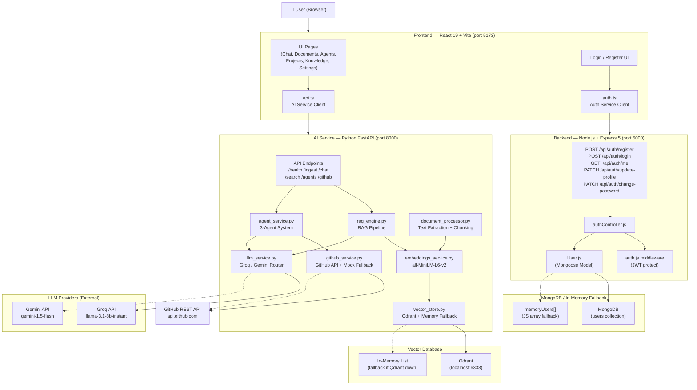

# AIRA — Current Architecture

**Derived from actual source code.** Not from README claims.  
**Date:** 2026-09-09

---

## 1. High-Level System Architecture



---

## 2. Component Breakdown

### 2.1 Frontend (React 19, TypeScript, Tailwind CSS, Vite)

| Aspect | Detail |
|--------|--------|
| Framework | React 19 |
| Language | TypeScript 6 |
| Build Tool | Vite 8 |
| Styling | Tailwind CSS 4 (utility classes) + Vanilla CSS |
| Routing | React Router DOM 7 (client-side) |
| State | Component-level `useState` — no global state manager (no Redux, no Zustand) |
| Auth State | `localStorage` — token stored as `aira_token`, user as `aira_user` |
| Theme | Context API (`ThemeContext.tsx`) — dark/light, persisted to localStorage |
| API Clients | `services/api.ts` (FastAPI) + `services/auth.ts` (Node backend) |

**API Target Separation:**
- `auth.ts` → `http://localhost:5000/api` (Node backend)
- `api.ts` → `http://localhost:8000/api/v1` (FastAPI AI service)

**Routes:**

| Path | Component | Connected API |
|------|-----------|---------------|
| `/` | Redirect → `/dashboard` | — |
| `/dashboard` | Dashboard (static stats) | None (hardcoded data) |
| `/chat` | ChatPage | FastAPI `/chat` (LIVE) |
| `/documents` | DocumentsPage | FastAPI `/ingest/*` (LIVE) |
| `/knowledge` | KnowledgePage | FastAPI `/search` (PARTIAL) |
| `/projects` | ProjectsPage | FastAPI `/github/*` (LIVE — mock fallback) |
| `/agents` | AgentsPage | FastAPI `/agents/*` (LIVE) |
| `/settings` | SettingsPage | Node backend `/auth/update-profile`, `/auth/change-password` (LIVE) |
| `/help` | HelpPage | None (static) |
| `*` | NotFoundPage | None |

---

### 2.2 Backend (Node.js + Express 5)

| Aspect | Detail |
|--------|--------|
| Framework | Express 5 |
| Language | JavaScript (CommonJS) |
| Database | MongoDB via Mongoose 9 |
| Auth | JWT (`jsonwebtoken`) — 7d expiry |
| Password Hashing | bcryptjs (salt rounds = 12) |
| Port | 5000 |
| Fallback | In-memory `memoryUsers[]` array if MongoDB unavailable |

**Endpoints:**

| Method | Path | Auth | Purpose |
|--------|------|------|---------|
| POST | `/api/auth/register` | None | Create user account |
| POST | `/api/auth/login` | None | Authenticate, return JWT |
| GET | `/api/auth/me` | JWT | Return current user profile |
| PATCH | `/api/auth/update-profile` | JWT | Update name/role |
| PATCH | `/api/auth/change-password` | JWT | Change password |
| GET | `/api/health` | None | Service health check |

> **Critical Gap:** The Node backend has no routes for documents, workspaces, conversations, or proxying to the AI service. It is an **auth-only** microservice.

---

### 2.3 AI Service (Python FastAPI)

| Aspect | Detail |
|--------|--------|
| Framework | FastAPI |
| Language | Python 3.13 |
| Server | Uvicorn |
| Auth | **NONE — all endpoints are publicly accessible** |
| Port | 8000 |
| Docs | Swagger at `/docs`, ReDoc at `/redoc` |

**Endpoints:**

| Method | Path | Purpose |
|--------|------|---------|
| GET | `/api/v1/health` | Service health + vector count |
| POST | `/api/v1/ingest` | Upload + chunk + embed + store document |
| GET | `/api/v1/ingest/list` | List indexed documents |
| DELETE | `/api/v1/ingest/{filename}` | Remove document from vector store |
| POST | `/api/v1/chat` | RAG Q&A with citations |
| GET | `/api/v1/chat/stream` | SSE streaming RAG response |
| GET | `/api/v1/search` | Raw semantic search |
| GET | `/api/v1/agents` | List available agents |
| POST | `/api/v1/agents/execute` | Execute an agent |
| GET | `/api/v1/github/repos` | List GitHub repos (real or mock) |
| GET | `/api/v1/github/issues` | List GitHub issues (real or mock) |
| GET | `/api/v1/github/pulls` | List GitHub PRs (real or mock) |

---

### 2.4 Database

| Component | Technology | Purpose | Persistence |
|-----------|------------|---------|-------------|
| Users | MongoDB (Mongoose) | Auth user records | Persistent (when connected) |
| Users (fallback) | In-memory JS array | Auth fallback | Lost on restart |
| Vectors | Qdrant | Document embeddings | Persistent (when running) |
| Vectors (fallback) | In-memory Python list | Vector fallback | Lost on restart |

**MongoDB Schema (User):**
```
{
  name: String (required)
  email: String (required, unique, lowercase)
  password: String (required, minlength: 6, select: false)
  role: "admin" | "member" | "viewer" (default: "member")
  avatar: String (default: "")
  isActive: Boolean (default: true)
  createdAt: Date (auto)
  updatedAt: Date (auto)
}
```

**No other MongoDB models exist.** There is no Document model, no Conversation model, no Workspace model.

---

### 2.5 Vector Database (Qdrant)

| Setting | Value |
|---------|-------|
| Host | localhost |
| Port | 6333 |
| Collection | `aira_knowledge` |
| Vector Size | 384 (all-MiniLM-L6-v2) |
| Distance | Cosine |
| Fallback | In-memory Python list |

**Stored payload per vector:**
```json
{
  "text": "chunk text",
  "filename": "document.pdf",
  "chunk_index": 0
}
```

---

### 2.6 LLM Layer

| Provider | Model | API Key Var | Priority |
|----------|-------|-------------|---------|
| Groq | llama-3.1-8b-instant | `GROQ_API_KEY` | Primary |
| Gemini | gemini-1.5-flash | `GEMINI_API_KEY` | Fallback |
| Local | Echo message | — | Fallback if no key |

Provider selected by `LLM_PROVIDER` env var (`"groq"` or `"gemini"`). Both use `temperature=0.3`.

---

### 2.7 Embedding Model

| Setting | Value |
|---------|-------|
| Model | `all-MiniLM-L6-v2` |
| Library | `sentence-transformers` |
| Dimensions | 384 |
| Normalization | Yes (cosine similarity) |
| Loading | Singleton — loaded once at first request |

---

### 2.8 Agent System

**Not LangGraph.** Custom Python function-call agent without a graph framework.

| Agent ID | Name | Tools Available |
|----------|------|----------------|
| `knowledge` | Knowledge Agent | search_knowledge, summarize_document, answer_question |
| `engineering` | Engineering Agent | search_knowledge, list_github_repos, get_github_issues, get_github_pulls, answer_question |
| `task` | Task Agent | search_knowledge, create_task, answer_question |

**Agent execution flow (single-pass, NOT iterative):**
1. Search knowledge base
2. (If engineering/github keywords) Call GitHub tools
3. Build context string
4. Call LLM with enriched prompt
5. (If task agent + action keyword) Create simulated task
6. Return response

> **This is NOT a LangGraph agent.** It is a scripted multi-step function that calls tools in a predetermined order, not a graph-based planning/execution loop.

---

### 2.9 GitHub Integration

| Scenario | Behavior |
|----------|----------|
| `GITHUB_TOKEN` set + valid | Real GitHub REST API calls (`/user/repos`, `/repos/{}/issues`, `/repos/{}/pulls`) |
| `GITHUB_TOKEN` not set | Returns hardcoded mock repositories, issues, PRs |
| `GITHUB_TOKEN` set but invalid | API returns error → falls back to empty list `[]` |

> **IMPORTANT:** The mock data shows fake repositories (`aira-workspace/AIRA`, `aira-workspace/payment-service`, `aira-workspace/customer-portal`) that do not exist. When the presenter uses mock fallback, the data displayed is fabricated.

---

## 3. Communication Flows

### 3.1 Authentication Flow
```
User (Browser)
  → POST /api/auth/login { email, password }
  → Node Backend (port 5000)
  → MongoDB (or memoryUsers[])
  → bcrypt.compare(password)
  → jwt.sign({ id }) → token
  → Response { token, user }
  → localStorage.setItem("aira_token", token)
  → AuthGate re-renders → Dashboard shown
```

### 3.2 Document Ingestion Flow
```
User uploads file
  → DocumentsPage.tsx
  → ingestDocument(file) in api.ts
  → POST /api/v1/ingest (FormData)
  → FastAPI (port 8000)
  → document_processor.extract_text() → raw text
  → document_processor.chunk_text() → chunks[]
  → embeddings_service.embed_texts(chunks) → vectors[]
  → vector_store.add_documents() → Qdrant (or memory)
  → Response { chunks_created, vectors_stored }
```

### 3.3 RAG Chat Flow
```
User types question
  → ChatPage.tsx
  → sendChatMessage(query) in api.ts
  → POST /api/v1/chat { query, top_k }
  → FastAPI
  → rag_engine.run_rag_query()
    → vector_store.similarity_search() → top-K chunks
    → Build context string
    → llm_service.get_llm_response(SYSTEM_PROMPT, context+query)
      → Groq or Gemini API
    → Calculate confidence score (avg top-3 cosine scores * 1.15)
    → Format citations
  → Response { answer, confidence, citations, reasoning_steps }
  → Chat UI renders message with badges
```

### 3.4 Agent Execution Flow
```
User selects agent + types query
  → AgentsPage.tsx
  → executeAgent(agent_id, query) in api.ts
  → POST /api/v1/agents/execute { agent_id, query }
  → FastAPI
  → agent_service.execute_agent()
    → tool_search_knowledge(query) → similarity_search()
    → [if engineering] tool_get_github_issues/repos/pulls()
    → Build enriched context
    → get_llm_response(agent_system_prompt, context+query)
    → [if task agent + action kw] tool_create_task() (simulated)
  → Response { steps, answer, task_created, knowledge_results }
```

---

## 4. What is MISSING from the Architecture

| Gap | Impact |
|-----|--------|
| No auth on AI service endpoints | Anyone can upload docs, query, delete — no security |
| No conversation history storage | Chat history is only in browser memory — lost on refresh |
| No workspace isolation | All users share the same vector store — documents not isolated |
| No hybrid search (BM25) | Only cosine similarity — keyword-heavy queries underperform |
| No reranking | Results ranked purely by embedding similarity |
| No real LangGraph | Agent is a scripted function, not a planning graph |
| No knowledge graph | Knowledge graph is not implemented at all |
| No persistent document metadata | Only filenames stored — no upload date, size, owner |
| No rate limiting | Endpoints can be abused |
| No tests | Zero test coverage |
| No Docker | No containerization |
| No CI/CD | No automated pipeline |
| Dashboard stats hardcoded | Not connected to real data |
